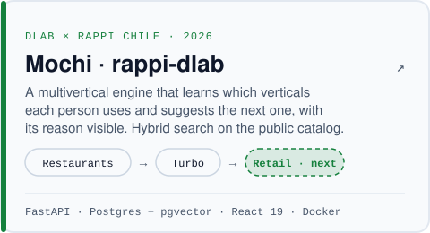
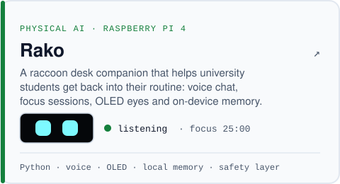
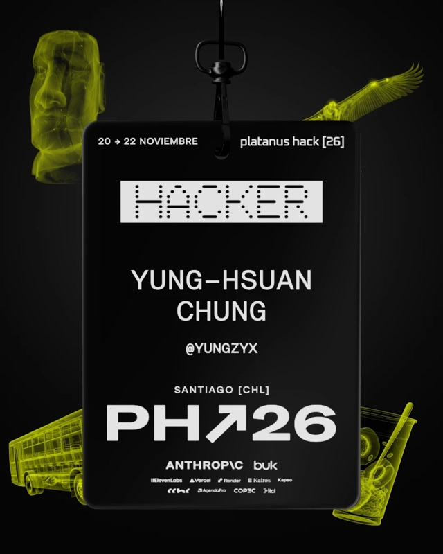

<picture>
  <source media="(prefers-color-scheme: dark)" srcset="assets/hero-dark.svg">
  
</picture>

> **Hi, I'm Yung.** I build AI products end to end from Chile. Many of my project docs are in Spanish; the code speaks every language.

- I build AI products **end to end**: scraping and data in Postgres + pgvector, evaluated hybrid search, FastAPI services, React front ends, and the occasional robot.
- I care about AI that is **honest about its limits**: visible reasons for every suggestion, safe answers, consent-first data.
- **Right now:** wrapping up Mochi with team Rappitouille in the dLab program, and heading to **Platanus Hack 26** (Nov 20–22, Santiago).

## Featured work

<a href="https://github.com/yungzyx/rappi-dlab-mvp"><picture><source media="(prefers-color-scheme: dark)" srcset="assets/card-mochi-dark.svg"></picture></a>
<a href="https://github.com/yungzyx/rako-pi"><picture><source media="(prefers-color-scheme: dark)" srcset="assets/card-rako-dark.svg"></picture></a>

## Hackathons & programs

<table>
  <tr>
    <td width="220"></td>
    <td>
      NEXT UP · NOV 20–22, 2026 · SANTIAGO
      <h3>Platanus Hack 26</h3>
      
I'm competing as a <b>hacker</b> in the Santiago Arcade Challenge. Whatever I build that weekend will land here.

    </td>
  </tr>
</table>

| When | Where | What I built |
| :--- | :--- | :--- |
| **Sep–Nov 2026** | dLab program × Rappi Chile | [**Mochi**](https://github.com/yungzyx/rappi-dlab-mvp): a multivertical engine + navigable app prototype + business panel, on the real public catalog with hybrid pgvector search. [Full project history](https://github.com/yungzyx/project-rappi-dlab-v0). |
| **2026** | Hack4Seniors · UDD | [**Silver Minds**](https://github.com/yungzyx/Hackaton-Hack4Seniors-UDD): a screen-and-voice assistant for older adults, with confirmed memory, RAG, safe responses and a consent-based family panel. |
| **2025** | IBM Applied Data Science Capstone | [**SpaceX Falcon 9**](https://github.com/yungzyx/SpaceX-LLM-YungC.): an ML pipeline that predicts first-stage landing outcomes. |

## Toolbox

<picture>
  <source media="(prefers-color-scheme: dark)" srcset="https://skillicons.dev/icons?i=py,fastapi,postgres,docker,react,vite,js,raspberrypi,linux,githubactions&theme=dark">
  
</picture>

Plus pgvector, embeddings (`multilingual-e5`), RAG and the Claude API.

## Activity

 

<picture>
  <source media="(prefers-color-scheme: dark)" srcset="https://raw.githubusercontent.com/yungzyx/yungzyx/output/snake-dark.svg">
  
</picture>
